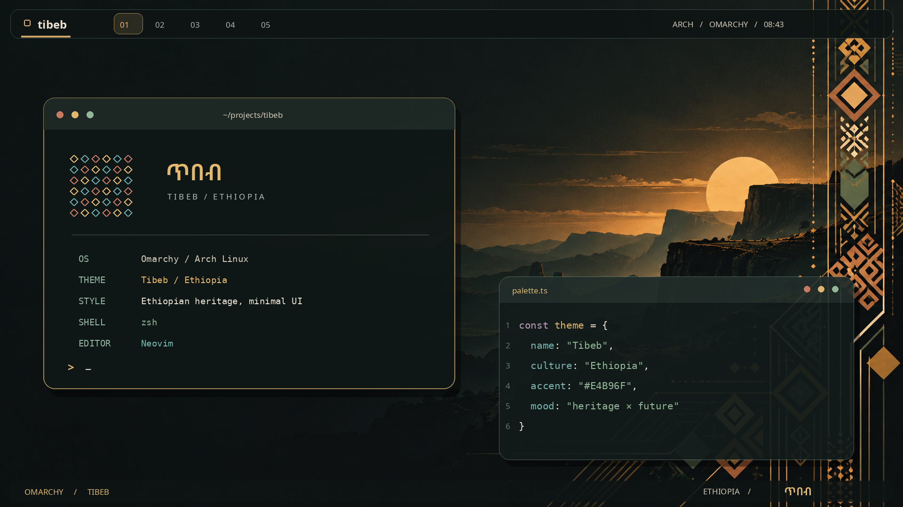

# TIBEB / ጥበብ — Omarchy Theme

**Ancient patterns. Modern pixels.**

TIBEB is an Ethiopian-inspired, dark-first Omarchy theme built around volcanic charcoal, highland gold, the structure of woven *tibeb* borders, and the warmth of natural cotton. It takes inspiration from Ethiopia without resorting to a literal green-yellow-red flag overlay.



> **Preview disclosure:** `preview.png` is a designed **desktop concept mockup**, not a screenshot from a running Omarchy installation. Actual terminal layout, icons, widgets, and fonts are controlled by the installed system and your configuration.

## Try it on Ubuntu first

The [Ubuntu GNOME edition](ubuntu/README.md) applies the wallpaper, a dedicated
GNOME Terminal profile, and matching native dark desktop colors. It saves your
current settings so you can restore them:

```bash
/usr/bin/python3 ubuntu/theme.py apply
# Undo:
/usr/bin/python3 ubuntu/theme.py restore
```

The Omarchy theme below remains ready for your later switch.

## Included

- `colors.toml` — native dark Omarchy palette. On supported Omarchy builds, this drives colors across Hyprland, shell UI, terminals, editors, and compatible apps.
- `backgrounds/tibeb-highlands.png` — original wallpaper designed for this theme, with Ethiopian-inspired highland atmosphere and abstract geometric motifs.
- `icons.theme` — standard Yaru-olive icons for an earthy look (when available).
- `preview.png` — 16:9 competition/chooser concept preview.

The installed theme contains only the palette, icons preference, and PNG assets.
`install.sh` and `scripts/validate.py` are local development helpers; Omarchy does
not execute them when installing this repository by URL. No custom application
configs or Lua overrides are needed.

## Install on an Omarchy desktop

Use an up-to-date Omarchy desktop with support for semantic `colors.toml`
palettes. From this project's directory, run (requires Python 3.11 or newer):

```bash
bash install.sh --apply
```

This validates the palette and PNG assets, checks for Omarchy's template renderer,
installs the theme, and switches to Tibeb. An existing `tibeb` directory or symlink
is moved to a uniquely named backup under `~/.local/state/tibeb/backups/` first.
Run `bash install.sh` without `--apply` to install without switching.

For a manual install without Python, run from this project's directory:

```bash
mkdir -p ~/.config/omarchy/themes/tibeb/backgrounds
cp colors.toml icons.theme preview.png ~/.config/omarchy/themes/tibeb/
cp backgrounds/tibeb-highlands.png ~/.config/omarchy/themes/tibeb/backgrounds/
omarchy-theme-set tibeb
```

Use the manual commands for a fresh install; the helper above handles backups
when replacing an existing installation.

Alternatively, publish the `omarchy-tibeb-theme` directory as the **root of a public GitHub repository**, then install using:

```bash
omarchy theme install https://github.com/YOUR_USERNAME/omarchy-tibeb-theme
```

Use the Omarchy menu > Style > Theme if you prefer the GUI. Omarchy and its CLI must already be installed; this is **not** a general GNOME/Ubuntu theme.

## Palette

| Role | Color |
| --- | --- |
| Volcanic Night / Background | `#141A1A` |
| Aksum Gold / Accent | `#E4B96F` |
| Cotton Ivory / Text | `#E9E2D3` |
| Highland Sage / Green | `#92B697` |
| Lake Tana / Cyan | `#7AB6B0` |
| Terracotta / Error | `#D27869` |
| Clay / Orange | `#D99666` |
| Mist / Blue | `#85A9C4` |

## Design rationale

1. **Culture in the geometry, not clichés:** Ethiopian woven textile patterns are referenced in the wallpaper's right-side border and the preview ornament.
2. **Readable for actual work:** A neutral near-black background keeps code and editor panes calm, while ivory provides text contrast.
3. **Distinctive at a glance:** A single amber-gold focus color repeats across window accents, selection, and key brand elements.
4. **Consistent across the OS:** Omarchy auto-generates application palettes using `colors.toml`, reducing bespoke maintenance.
5. **Wallpaper designed for tiled windows:** Large negative space on the left and the visual focal point on the right accommodates real workspaces.

## Competition submission blurb

**TIBEB (ጥበብ)** combines Ethiopian textile geometry, layered highland landscapes, volcanic-dark surfaces, and warm metallic gold into a restrained, developer-friendly Omarchy experience. Its design makes heritage present in shape, rhythm, and texture—not only color—while preserving the speed and clarity of modern Linux desktops.

## Notes

- The artwork was generated with AI assistance and composed specifically for this theme. **Check the contest rules before submission** if AI-assisted visuals are restricted.
- The validator checks TOML syntax, required palette colors, the icon preference, and PNG chunk checksums and compressed data. The theme **has not been run on a live Omarchy installation** in this environment.
- The UI in the preview is conceptual; the actual application and terminal arrangements are up to you.
- The theme assets may be adapted by you for your project or contest entry. Review any applicable contest attribution rules.

Theme reference: https://omarchy.org/manual/making-your-own-theme/

## Validate and troubleshoot

```bash
python3 scripts/validate.py
```

If the installer reports that Omarchy is missing, run it on your Omarchy desktop.
It does not install Omarchy itself. If Omarchy is present but colors do not apply,
update Omarchy to a version supporting the current semantic palette, then run
`omarchy-theme-set tibeb` again. Restart an application if it retains its old colors.

If the wallpaper is missing, confirm that
`~/.config/omarchy/themes/tibeb/backgrounds/tibeb-highlands.png` exists and reapply
the theme. The preview is a concept image, not an additional wallpaper.

To return to your previous desktop theme, select it in Style > Theme. To restore
an older Tibeb installation, move the current `tibeb` folder aside and move the
backed-up `tibeb` folder printed by the installer into `~/.config/omarchy/themes/`,
then reapply it.
